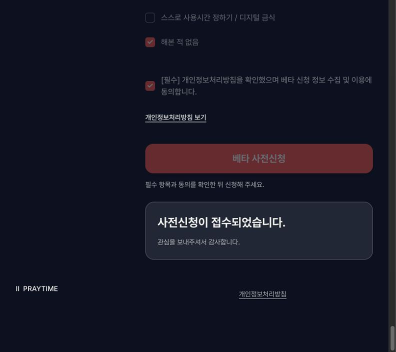

> 이 문서는 이전 구현/승인 QA 이력입니다. 최신 디자인 동결·Git·자동 테스트 준비 상태는 [PRE_FIGMA_STATUS.md](PRE_FIGMA_STATUS.md)를 참조하세요. 이번 준비 단계에는 추가 DB 변경/운영 POST를 하지 않았고 로컬 persistence는 disabled입니다.

# Mission 5 동의 기록 및 실제 POST 검증

검증일: 2026-11-06 (Asia/Seoul)

## Migration

적용 파일: `supabase/migrations/20261105165403_mission5_signup_consent_recording.sql`

기존 Lovable 프로젝트의 DB 연결로 `public.beta_signups`에 다음 컬럼을 추가했습니다.

| 컬럼 | 타입 | NULL 허용 | 기본값 |
| --- | --- | --- | --- |
| privacy_consent_at | timestamptz | YES | 없음 |
| privacy_policy_version | text | YES | 없음 |
| signup_source | text | YES | 없음 |

CLI 3.0.0으로 migration 파일을 생성했고 Lovable DB 도구로 SQL을 적용했습니다. 새 DB, NOT NULL, default, 기존 행 backfill, RLS 변경, 추가 조회/수정/삭제 권한은 없습니다. 짧은 transaction과 lock_timeout 5초, statement_timeout 30초를 적용했습니다.

RLS, 정책 정의, 이메일 UNIQUE 제약은 적용 전후 동일함을 확인했습니다. 공개 SELECT/UPDATE/DELETE 정책을 추가하지 않았습니다. Supabase 보안 advisor는 이 Lovable Cloud 프로젝트에 대한 직접 접근 권한이 없어 실행할 수 없었으며, Lovable의 DB catalog 조회로 실제 정책과 제약을 검증했습니다.

## 실제 저장 필드

기존 nickname, email, os, signup_reason, age_range, target_apps, reduction_methods 및 attribution 5개를 유지합니다. DB는 id와 created_at을 자동 생성합니다.

Mission 5 서버가 추가하는 값:

- `privacy_consent_at`: server-side `new Date().toISOString()`
- `privacy_policy_version`: `privacy-sha256:e3cac7e88efaa05063c27bf85c12ddbd25250962be6ce70ccc003f9fb8ef8f83`
- `signup_source`: `mission5_landing`

고지 버전은 현행 공개 문구 snapshot의 SHA-256 식별자입니다. 법적 시행일을 새로 부여한 값이 아닙니다. 원문과 canonicalization은 `docs/privacy/`에 보관했습니다. 승인된 새 고지로 교체되면 snapshot과 identifier도 함께 갱신해야 합니다.

서버는 consent가 true인 요청만 허용하며, client가 임의로 보낸 timestamp/version/source는 무시합니다. boolean consent 컬럼은 만들지 않았습니다. 이전 Lovable 폼은 이 metadata를 보내지 않아도 동작하며, 기존 행에 소급 동의를 기록하지 않습니다.

## POST 성공 여부

production build의 실제 UI → `/api/beta-signup` → 기존 Supabase table 경로로 QA 신청 1건이 저장됐습니다.

- QA nickname: `QA_MISSION5_CONSENT_54700a47`
- QA email: `qa-mission5-consent-20261106-54700a47@example.com`
- 저장 id: `045aaf08-e1d9-46c8-8c0d-1d93b902fb6f`
- 응답: `201 {"status":"success","receipt":true}`
- consent 시각: `2026-11-06 01:58:23.447 KST` (`2026-11-05T16:58:23.447Z`)
- DB 생성 시각: `2026-11-06 01:58:24.378151 KST`
- policy version과 signup_source가 기대값과 일치

QA 전용 로컬 reverse proxy가 실제 성공 응답을 잠시 보류하는 동안 UI는 loading=true, success=false였습니다. 응답 전달 이후에만 success=true가 됐습니다. 모의 성공 응답을 사용하지 않았습니다.

## Duplicate 테스트 여부

동일 QA 이메일을 UI에서 다시 제출했습니다.

- 기존 `beta_signups_email_key UNIQUE(email)` 유지
- 응답 `409 {"status":"duplicate"}`
- UI에 이미 신청된 이메일 상태 표시
- generic server error나 success로 표시되지 않음
- 재조회한 QA 행은 1건이며 id·동의 시각·버전 등 모든 값이 그대로임

consent=false의 유효한 나머지 QA payload를 직접 POST하면 `422 invalid`와 consent 오류를 반환합니다. 저장 호출 전에 거부됩니다.

기존 사용자 행은 조회·변경하지 않았습니다. 검증 후 명확히 식별되는 QA 행 1건을 그대로 남겼습니다. 재실행해 새 QA 데이터를 자동 생성하는 live test script는 프로젝트에 추가하지 않았습니다.

## Privacy policy 불일치 여부

비교 기준: 현재 `https://praytime.glorifier.kr/privacy`의 문구. 법률 문구는 수정하지 않았습니다.

| Mission 5 수집 항목 | 현행 고지 | 불일치 |
| --- | --- | --- |
| 닉네임: 필수 | 언급 없음 | 수집 항목 누락 |
| 이메일: 필수 | 이메일 필수 | 일치 |
| 사용 기기: 필수 | 선택으로 표기 | 필수/선택 불일치 |
| 신청 이유: 필수 | 언급 없음 | 수집 항목 누락 |
| 연령대: 선택 | 선택으로 표기 | 일치 |
| 줄이고 싶은 앱: 선택 | 관심 앱: 선택 | 범주는 있으나 실제 질문과 명칭이 다름 |
| 최근 3개월 사용 감소 시도: 선택 | 스크린타임 사용 경험: 선택 | 실제 7가지 방법이 더 넓은 범위 |
| 동의 시각·고지 버전·신청 출처 | 동의 기록 언급 없음 | 새 동의 metadata 고지 누락 |

고지에 기존 attribution(UTM/referrer)은 이미 포함됩니다. signup_source는 고정된 내부 유입 식별값이므로 별도 처리 필요 여부와 함께 고지 정합성을 검토할 항목입니다.

## lint / typecheck / test / build

- lint: PASS
- typecheck: PASS
- unit test: 21개 PASS, consent 누락/false·server time·spoof 무시·policy hash·전송 헤더·duplicate 포함
- production build: PASS
- 실제 통합 QA: 201 success / 409 duplicate / 422 invalid / DB 기록 / UI receipt gate PASS
- client chunk 검사: backend 연결 key 값 노출 없음. secret/service-role key 사용 없음

## Deployment blocker

현행 개인정보 고지의 위 불일치를 승인된 문구로 보완하고, 실제 공개 고지와 서버의 snapshot/version identifier를 일치시켜야 합니다. 법률 문구를 임의 작성하지 않았으므로 이 항목은 남아 있습니다. 배포는 수행하지 않았습니다.

증거: `docs/evidence/qa-live-http-results.json`, `qa-consent-persisted-row.json`, `qa-ui-receipt-gate.json`, `consent-migration-security-verification.json`.
